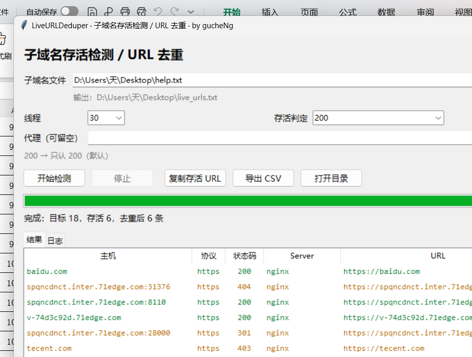

## LiveURLDeduper

子域名存活检测 + URL 去重。输入 subfinder / oneforall 跑出来的子域名列表，输出一份「每个主机一条、优先 https」的存活 URL 列表。

搭配 subfinder 食用更佳：

```bash
subfinder -d example.com -silent > subs.txt
```



### 1. 直接使用

三种方式，任选：

```bash
# 图形界面（双击 run_gui.bat 也行）
python -m liveurldeduper

# 命令行（适合脚本 / 流水线）
python -m liveurldeduper -i subs.txt -o live_urls.txt -t 100

# 打包成 exe（默认把 myicon.ico 打成 exe 图标）
build_exe.bat

# 想换图标：传路径就行，png/jpg 会自动转成多尺寸 ico
build_exe.bat D:\icons\my.ico
```

打包脚本会先把图标规整到 `build/app.ico` 再过给 `LiveURLDeduper.spec`（通过 `LIVEURLDEDUPER_ICON`）：

- 传进来已经是合法 `.ico` → 原样复用，并列出里面有哪些尺寸；
- 传进来是 png/jpg → 用 Pillow 补透明边成正方形，再生成 16/24/32/48/64/72/96/128/256 九帧（缺 Pillow 会直接报错提示 `pip install pillow`，不会默默出一个白块图标）；
- 图标头不对/文件不存在/`dist\LiveURLDeduper.exe` 还开着 → 直接失败退出，报错写清楚下一步该干什么。

依赖只有一个：

```bash
pip install -r requirements.txt      # requests[socks]
```

界面上只需要选一个输入文件，结果自动写到**输入文件同目录的 `live_urls.txt`**（界面上会直接显示完整路径），没有多余的输出路径选项。CLI 的 `-o` 只作为可选的覆盖项保留。

界面只留三个参数：线程数、存活判定、代理（一行 URL）。超时、重试、TLS 校验这些低频选项不在界面上，需要就用 CLI。装了 `tkinterdnd2` 之后可以直接把 txt 拖进窗口：

```bash
pip install tkinterdnd2      # 可选，不装也能用
```

### 存活判定选哪个

界面的下拉框只有三个预设，不能手打——手打错一个字符就会把整批目标判死。默认 **`200`**：

| 规则 | 含义 |
| --- | --- |
| `200` **（默认）** | 只认 200，最严；301/302 跳转、401/403 鉴权墙都算死 |
| `200-399,401,403` | SRC 推荐：2xx/3xx 页面 + 401/403 鉴权墙，排掉 404 泛解析和 5xx 噪声 |
| `any` | 任何 HTTP 响应都算活（含 404/500），先摸清多少主机起了 Web 服务 |

更细的组合（`2xx`、`200,301,302`、`200-299,301,302,401,403` …）走 CLI 的 `--alive`，随便写。

一个容易踩的细节（已修）：以前探测一旦拿到响应就直接 return，`https` 返回 404、`http` 返回 200 的主机会被判死。现在**状态码不命中会继续试另一个协议**，命中才算活；两个都不命中时，报第一个响应（表格里仍能看到 404）。

> GUI 默认 `200`；CLI 的 `--alive` 默认仍是 `any`（流水线里通常要全量状态码自己筛）。

### 2. 命令行参数

```text
-i, --input            子域名/URL 列表文件，每行一个
-o, --output           存活 URL 输出文件（默认与输入同目录 live_urls.txt）
-t, --threads          并发线程数（默认 50）
--connect-timeout      TCP/TLS 连接超时秒数（默认 4）
--read-timeout         响应等待超时秒数（默认 6）
--retries              失败重试次数（默认 0）
--alive                存活判定：any / 2xx / 200-399 / 200-399,401,403（SRC 推荐；默认 any）
--proxy                代理，如 socks5://127.0.0.1:1080
--verify-tls           校验 TLS 证书（默认不校验）
--follow-redirects     跟随 3xx
--tls-error-alive      TLS 握手失败也算存活（自签名证书场景）
--csv / --json         额外导出明细 CSV / JSON（JSON 含统计，方便二次处理）
-q, --quiet            只输出汇总
```

示例：

```bash
# 带 socks5 代理、按 SRC 推荐档筛、导出明细
python -m liveurldeduper -i subs.txt -t 150 --proxy socks5://127.0.0.1:1080 \
    --alive 200-399,401,403 --csv result.csv --json result.json
```

输入行兼容度较高，下面这些都能直接扔进去：

```text
a.example.com
A.Example.com:443
https://b.example.com/path?x=1
user:pass@c.example.com:8443
[::1]:8080
# 注释行、*.wildcard.com、非法端口会被自动跳过并计数
```

**文件编码自动识别**（不需要你手动转 UTF-8）：按 BOM → 大量 NUL（无 BOM 的 UTF-16）→ 严格 UTF-8 → GB18030 → latin-1 的顺序嗅探，读取结果里会显示实际用的编码。

- 记事本存成“Unicode”的 UTF-16 LE/BE、带 BOM 的 UTF-8（以前第一行会变成脏行）、GBK/GB18030 中文注释文件，都能直接跑；
- 判不出来时不会静默失败：界面会报“读入 N 行 / 编码 xxx / 跳过脏行 N”，提示问题出在编码还是内容。

### 3. 项目结构

```text
liveurldeduper/
  core.py        目标解析 / 存活探测 / 去重 / 导出（纯逻辑，无 UI，可单测）
  cli.py         命令行
  gui.py         Tkinter 界面（后台线程只写队列，主线程定时消费）
  __main__.py    python -m liveurldeduper
app.py           pyinstaller 打包入口
tools/
  prepare_icon.py  图标校验 / png→多尺寸 ico 转换（build_exe.bat 调用）
tests/           单测：python -m unittest discover -s tests -v
LiveURLDeduper.spec
```

### 4. 相比 1.0 的改动

**修掉的 bug**

- 输入带 `http://` 前缀时会拼成 `https://http://...`，必然失败 → 现在统一解析成 host + port。
- 后台线程直接操作 Tk 控件（`log` / `update_progress` 里调 `update_idletasks`），扫描量大时会卡死或崩溃 → 改成 `queue.Queue` + `root.after` 单线程消费。
- 进度条算法 `20 + 60 * ratio` 永远到不了 100，还会跳变 → 改成按实际完成数推进。
- 只认 200/301/302 存活，WAF 返回的 403/401 主机全被判死 → 默认「有 HTTP 响应即存活」，可自定义状态码范围。
- 去重时 `https://a.com` 与 `https://a.com:443` 被当成两个主机 → 归一化默认端口 + 大小写 + 尾部点。
- `except:` 吞掉所有异常，出错后按钮永久禁用 → `try/finally` 式收尾，异常回传界面。
- 端口填非数字、代理填错时直接把异常抛到 Tk 回调里 → 统一校验并提示。
- 日志无限追加，扫几万条后内存暴涨 → 上限 3000 行。

**性能**

- `requests.get` 每次新建 Session → 每线程复用一个 Session，并且 `stream=True` 只读响应头，不下载 body。
- 连接超时与读取超时分开设置，死主机不再干等 5 秒；`80/8080/8888` 等端口先试 http，省一次 TLS 握手失败。
- 结果边扫边写日志，不再等全量完成。

**2.0 的大文件卡死修复（实测数据）**

上一版重构把架构改对了（线程只写队列），但把几处热路径写成了 O(n²)。拿 20 万行子域名文件实测，卡死是这几个原因叠出来的：

| 位置 | 问题 | 实测代价 | 修法 |
| --- | --- | --- | --- |
| `_add_result` | 每插一行都调 `tree.get_children()` 数行数，返回的是全部行 id 的 tuple | 2 万行时 **1.71 ms/行**，2 万行共 34 s（不调是 0.01 ms/行） | 自己维护行数计数器，`get_children()` 只在复制时调一次 |
| `LogView.append` | 每行都 `index('end-1c')` + 到上限就从头删一行（Text 内部 O(n) 拷贝）+ `see(END)` | 满 3000 行后 **10 ms/行** | 整批 insert 一次，超出上限 +1000 行才批量裁一次，往上翻时不再强制滚到底 |
| `start()` | 在主线程 `read_text().splitlines()` + 全量解析 | 百万行直接冻住主线程十几秒 | 读取 + 解析 + 写结果全部挪到后台线程，流式按块读 |
| `scan()` | 一次性 submit 所有 future | 10 万目标峰值多出 **181 MB** + 数秒提交开销 | 滑窗提交，最多 `workers*4` 个在途，峰值降到 **16 MB** |
| `on_progress` | 每个结果回传一次同一个可变 `ScanStats` | 队列流量翻倍，UI 读到半更新对象 | 按 200ms 限流 + 发快照 |
| `_pump` | 每轮固定 500 条，每条都做上面两件事 | 每轮 5 秒起步 | 时间预算 12ms/轮 + 自适应批量（按实测耗时在 50~2000 行间调整） |
| `parse_target` | 每行都走 `urlsplit` | 5.7 µs/行，百万行 5.7 s | 裸 `host` / `host:port` 走不碰 urlsplit 的快路径，1.7 µs/行 |
| `export_csv` | 在主线程写几十万行 | 导出时界面冻住 | 挪到后台线程 |

现在的实测（20 万目标，假探测模拟 0~3 ms 延迟、50 线程，最坏情况——探测线程一直在抢 GIL）：

- 主线程单轮处理 **中位 3.8 ms，p99 41 ms**，整轮扫描界面不卡；
- 百万行文件：`start()` 主线程 **5 ms** 返回，解析在后台跑完，期间窗口可拖动；
- 取消后 **0.1 s** 内收尾（取消时 `cancel_futures`，不再等排队任务跑完）。

**“卡在最后一个目标不结束”（17/18）**

根因是 DNS：`requests` 的 `timeout` 只管 socket 读写，`socket.getaddrinfo` 没有超时参数，一个域名解析卡住，那个 worker 就永远不返回；而 `ThreadPoolExecutor` 的 worker 是非守护线程，`scan()` 不返回、退出时 `atexit` 还会 join 它，窗口关了进程也在。

两层修法：

- **硬截止时间**：`hard_deadline = (connect_timeout + read_timeout) * 2 + 5`（默认 25s），到点直接放弃该目标、记一条 `abandoned` 失败，扫描继续收尾。界面日志会写“放弃 `xxx`（超过 25s 未返回）”，状态栏也会显“在途 N（收尾中，卡住的最多等 25s 自动放弃）”。
- **守护线程池**：`core._DaemonPool` 替掉 `ThreadPoolExecutor`，被放弃的探测即使还卡在 DNS 里，也不会阻塞进程退出。

配置里能直接调：`--connect-timeout / --read-timeout` 越小，卡住的等待越短。

另外表格改成分开限额：存活行 8000、非存活行 2000，免得一堆 404 把存活主机挤出表格。

**功能**

- 新增 CLI + JSON 输出，可以被脚本和 agent 直接调用。
- 界面只需选输入文件，输出固定为输入同目录 `live_urls.txt`，少一次点击、也不会写错目录。
- 支持中途停止（点「停止」按钮，或按 Esc、关闭窗口），已探测的结果照样落盘；界面按钮只留：开始检测 / 停止 / 复制存活 URL / 导出 CSV / 打开目录。
- 结果表格显示状态码 / Server / 耗时，可复制选中行、导出 CSV、双击复制。
- 线程数、存活判定、代理自动保存，下次打开即用。
- 高 DPI 适配，Windows 高分屏不再糊。
- 单测覆盖解析、判定、去重、并发、流式读取、导出：`python -m unittest discover -s tests -v`。

### 5. 后续可选项

- 需要指纹/标题/截图，直接接 `httpx` + `whatweb` 的活，别在这个工具里堆。
- 上十万级目标建议换 asyncio + `aiohttp`，当前线程池在 1w 量级足够。

### 6. 广告：低价考各类安全证书咨询 wx：abcd2477231995

在就业竞争白热化的当下，一本高含金量证书就是你脱颖而出的利器！我们提供 CISP 系列、CISSP、软考、PMP、ISO27001 等热门认证服务，无论是信息安全、项目管理还是体系认证需求都能满足。组团报考享超值优惠，支持对公转账开票，学生报考 PTE 更有专属低价。早考早拿证，为简历镀金，敲开名企大门，机会不等人，速来咨询！
